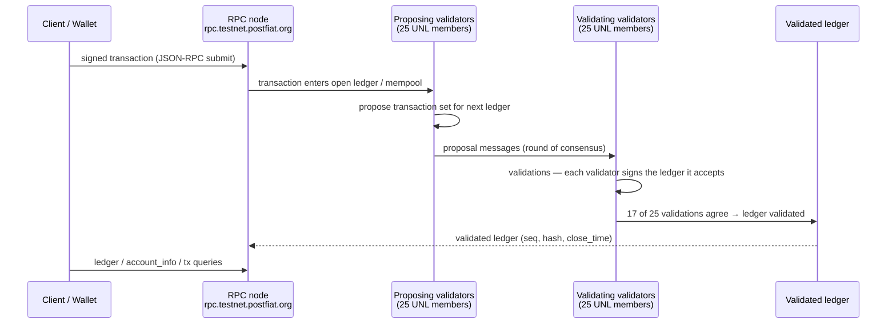
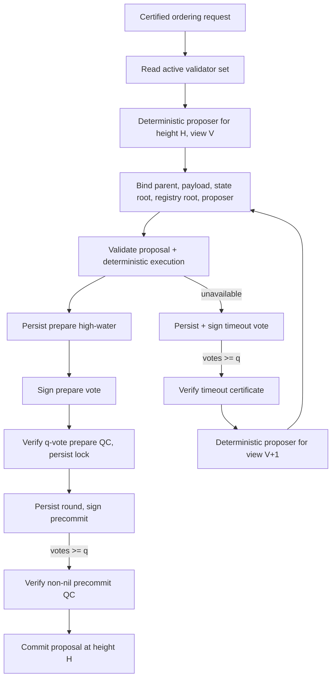

# Consensus message flow

There are **two** consensus stories in the PostFiat project, and conflating
them is the most common error in describing the network. This document keeps
them apart.

- **A. Live testnet (measured)** — `postfiatd` 1.0.9, a rippled fork: XRPL-style
  consensus with proposals, validations, and ledger closes. This is what the
  observations in this pack measure.
- **B. L1v2 design (specified)** — `postfiatl1v2`: Consensus v2
  (prepare/precommit QCs) plus Cobalt ratification of validator-trust changes.
  Specified in the whitepaper and the repo; **not** running on the testnet
  measured here.

## A. Live testnet consensus (measured 2026-11-13)

### Message flow (XRPL-style, as implemented by postfiatd)

### What was measured, step by step

| Step | Measurement | Evidence |
| --- | --- | --- |
| Ledger close | Mean close interval 3.036 s (median 3.000 s, range 2.727–3.333 s) over 21 samples / 600 s; 198 ledgers closed | `outputs/cadence-run1.jsonl`, `derived/cadence.json` |
| Convergence | `last_close.converge_time_s` ≈ 2.0 s in every sample (2.000–2.010) | same |
| Proposers | 25 in every `last_close` | same |
| Quorum | `validation_quorum: 17` in every sample; 17/25 = 68% | same; matches amendment threshold 0.67 in `.env.testnet` |
| Validation agreement | 24h missed 48 / 1,881,457 (0.00255%); 1h missed 0 | `derived/vhs.json` |
| Ledger growth | Validated seq 8,001,214 → 8,001,412 in 600.0 s (19.80 ledgers/min) | same |
| Fee burn | `total_coins` fell 60 drops in 31 s between two headers — 10 drops/ledger base fee | `outputs/rpc-ledger.json` vs `rpc-ledger_data.json`, `derived/ledger.json` |
| Queue | `current_queue_size: 0`, `max_queue_size: 2000`, median fee 5,000 drops, base fee 10 drops | `outputs/rpc-fee.json` |
| Retention | `complete_ledgers: 7,950,054–8,001,412` — ~51,359 ledgers retained on the probed node | `outputs/cadence-run1.jsonl` |
| Finality signal | `validated_ledger.age` 0–4 s; `server_state: full`; `load_factor: 1` | same |

### How finality is determined (live)

A ledger is validated when at least 17 of the 25 UNL validators sign the
same ledger hash. The pack verified the necessary condition on the live data:
at the sampled moment every validator's `current_index` (8,001,283 or
8,001,284) carried exactly **one** distinct ledger hash — no divergent hash
for any single index (see `derived/vhs.json`, `distinct_hashes_per_index`).
A conflicting validation for the same index would be detected by exactly
this check; the failure-recovery demo (`scripts/failure_recovery_demo.py`,
demo 4) runs it against the real snapshot and against a labeled synthetic
conflicting pair.

### What the live consensus is NOT

- It is not the l1v2 Consensus v2 prepare/precommit protocol (section B).
- It is not Cobalt-governed: on the live testnet, the UNL is the trust
  list, and there is no on-ledger Cobalt ratification visible in the public
  RPC surface. The VHS notes that UNL validators are fetched from the
  connected rippled node via the admin `validators` RPC — which the public
  proxy blocks (HTTP 403), so the UNL can only be read from the VHS API.
- There is no staking, no slashing, and no validator subsidy: the whitepaper
  states this explicitly, and the live data confirms fee burn with no reward
  flow visible in the ledger headers.

## B. L1v2 design consensus (specified, not live)

Sources: whitepaper (P2), `postfiatl1v2` docs (`fixtures/`
`postfiatl1v2-finality.md`, `postfiatl1v2-consensus-signing-rounds.md`,
`postfiatl1v2-genesis-spec-excerpt.md`,
`postfiatl1v2-launch-topology-excerpt.md`).

### Block consensus — Consensus v2

For a committee of `n` validators: `f = floor((n-1)/3)`,
`q = floor(2n/3)+1`. At each height:

1. The deterministic proposer for `(height, view)` signs the exact proposal
   (binding parent, payload, state root, registry root, proposer).
2. Validators verify deterministic execution, persist their highest prepare
   round, then sign a prepare vote.
3. `q` prepare votes form a prepare QC — the durable lock.
4. Validators persist the lock/high-QC and precommit round, then sign a
   precommit vote.
5. `q` precommit votes for the same non-nil block form the only commit QC.

A lone prepare QC has no commit authority. A view change requires a signed
timeout certificate for the same height at the previous view; a later-view
proposal must carry that timeout ID and the same valid-QC reference, and if
locked, must repropose the certified block. The signing-round contract adds
one durable round floor: `r >= max(r_P, r_C, r_T)` across prepare, precommit,
and timeout high-water marks (fixture
`postfiatl1v2-consensus-signing-rounds.md`).

### Validator-trust governance — Cobalt

Cobalt governs a different object than block consensus: agreement over
declared validator trust. A trust view lists essential subsets; a subset
with size `n_S`, fault budget `t_S`, threshold `q_S` must satisfy
`t_S < 2q_S - n_S` and `2t_S < q_S`. The devnet graph is one six-validator
subset with `t_S=1, q_S=5` (five-of-six ratifies). The August 2026 campaign
exercised: admission evidence → deterministic selector → Cobalt
(RBC → ABBA → MVBA → DABC) → distinct ML-DSA-65 authorizations from the
current registry (≥ q) → Consensus v2 orders the update → execution applies
it. At height 924 the legitimate rotation of validator 5 carried
authorizations from validators 0–4 and committed; the treated-as-stolen old
key's attempt (decision certificate + one signature) was rejected.

The genesis specification (fixture `postfiatl1v2-genesis-spec-excerpt.md`)
adds the launch profile `q_S = ceil(4·n_S/5)` and the quorum-degradation rule:
if the registry can no longer produce a valid transition certificate, no
administrator may lower quorum or edit membership — the state is
`REGISTRY_EVOLUTION_HALTED` and recovery is a coordinated successor testnet,
not an in-chain transition.

### Transaction lifecycle (l1v2 design)

Wallet signs (post-quantum account authorization) → controlled write path /
mempool → proposer forms a block/batch → validators verify and vote → quorum
votes form a certificate → node commits, burns fees, writes receipts → clients
query finality proof + receipt. Receipt semantics are mandatory: a committed
block may contain a rejected transaction; wallets report success only when the
finality proof verifies and the receipt code is accepted (fixture
`postfiatl1v2-finality.md`).

### Open obligation (stated in the whitepaper, not resolved)

The whitepaper states the consensus obligation exactly: the inspected signer
keeps separate durable high-water marks per phase, and precommit
authorization performs no comparison against a higher prepare or timeout view
already signed. A four-validator schedule (prepare X at view 0 with the
certificate withheld; open view 1, prepare Y; deliver X's certificate for a
first-ever lower-view precommit; deliver Y's newer certificate to replace the
lock) is admitted by separate counters. A durable cross-phase current-view
fence is a *proposed* normative rule; source review left its enforcement in
the current runtime unestablished. No exploit is claimed. This pack reports
the obligation as specified; it does not test the l1v2 runtime.
